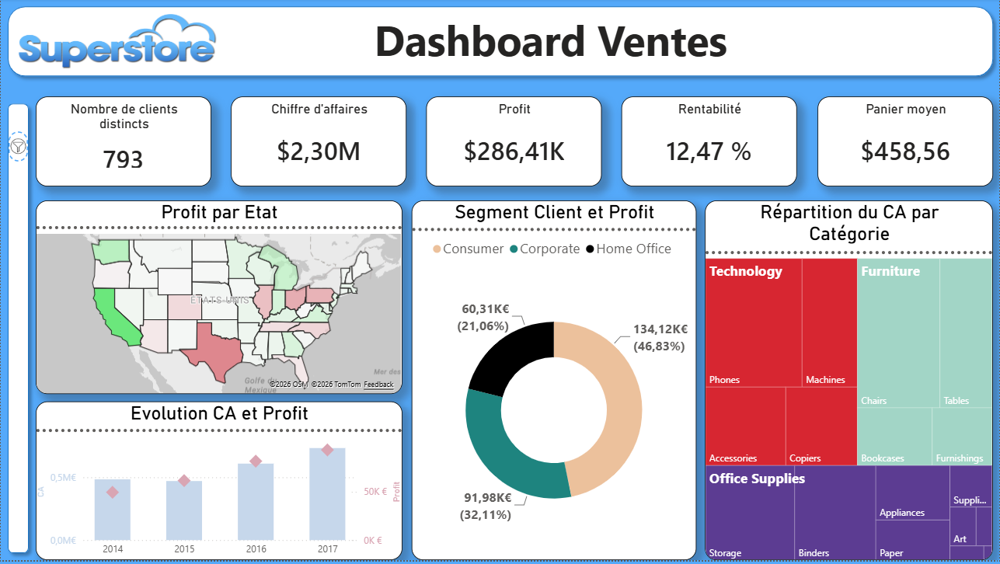
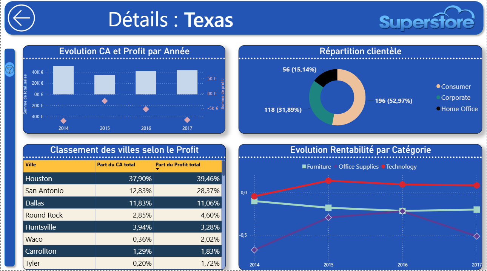
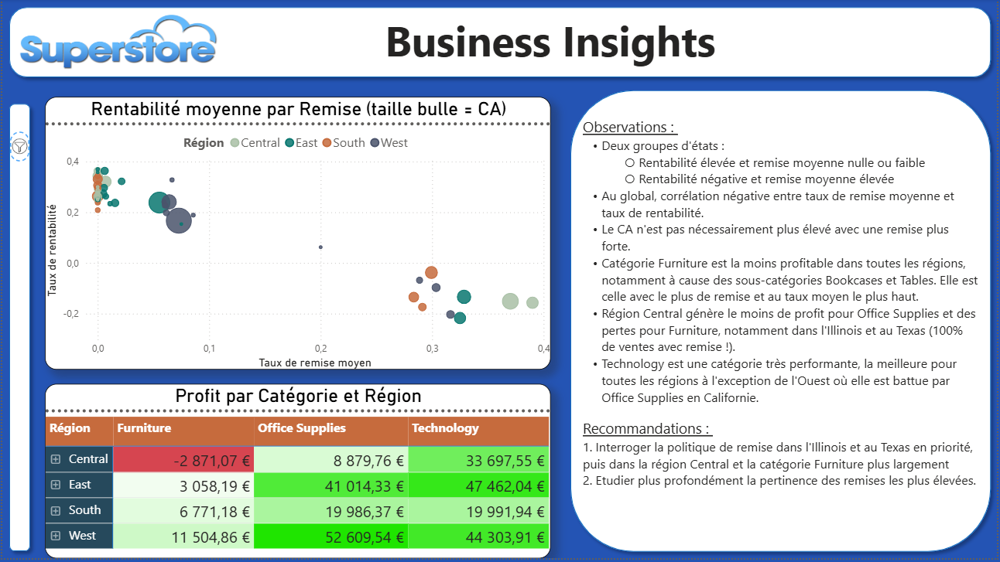

# Analyse des ventes de Superstore

## Présentation du projet 

Ce projet reproduit un workflow complet de Data Analysis à partir du jeu de données Superstore. Il couvre le nettoyage des données avec Python, la modélisation et l'analyse avec SQL, puis la création d'un tableau de bord interactif sous Power BI. Il illustre ma capacité à conduire une analyse de bout en bout, de la préparation des données à la restitution d'insights destinés à faciliter la prise de décision. 

## Dashboard

### Vue d'ensemble

### Analyse géographique

### Business insights

# Objectifs : 

* Nettoyer, assurer la qualité et préparer les données
* Créer un modèle relationnel 
* Étudier les résultats par état
* Analyser les performances en fonction des catégories de produits
* Présenter ce travail dans un tableau de bord de façon claire et pédagogique

## 

## Source des données 

https://www.kaggle.com/datasets/vivek468/superstore-dataset-final/data

## Structure du projet 

superstore\_sales\_analysis/ 

│

├── data/ 

│ ├── raw/ 

│ └── processed/ 

│ 

├── notebook/ 

│ └── data\_cleaning.ipynb 

│ 

├── sql/ 

│ ├── 01\_create\_tables.sql 

│ └── 02\_analysis.sql 

│ 

├── dashboard/ 

│ ├── superstore\_sales\_dashboard.pbix 

│ └── screenshots/ 

│ 	├── overview.png 

│ 	├── geography.png 

│ 	└── insights.png 

│ 

├── requirements.txt 

├── .gitignore 

└── README.md 

## Démarche 

### Nettoyage des données

Le notebook data\_cleaning.ipynb comprend : 

* l’exploration du jeu de données
* la standardisation des variables
* la conversion des types
* le changement de nom des variables
* la recherche et suppression de doublons
* la recherche d’incohérences dans les identifiants produits 
* la recherche de valeurs aberrantes
* la construction de nouvelles variables 
* la séparation du jeu de données en table de faits et de dimensions
* l’export vers MySQL et au format csv (optionnel)

Ce fichier est volontairement détaillé afin de donner un aperçu des contrôles effectués et du raisonnement qui sous-tendent les décisions de traitement prises. Le but est de rendre la démarche de nettoyage pleinement transparente.

### Création du modèle relationnel 

Le fichier 01\_create\_tables.sql contient : 

* la définition de la structure des tables 
* les clés primaires et étrangères pour chaque table

### Analyse

Le fichier 02\_analysis.sql est consacré à : 

* la segmentation de la clientèle en fonction du nombre de commandes passées
* un aperçu des variations temporelles des ventes
* une étude de la répartition géographique de l’activité
* une évaluation des profils clients les plus porteurs
* l’identification des catégories de produits les plus performantes
* l’analyse des causes potentielles des pertes
* la formulation de recommandations

### Présentation 

Le tableau de bord superstore\_sales\_dashboard.pbix présente : 

* un bilan global des ventes
* un détail des résultats par état
* une comparaison des catégories de produits
* une analyse détaillée d’une catégorie 
* les observations les plus marquantes et les recommandations 

## Principaux résultats

### Géographie 

* New York (région Est) et la Californie (région Ouest) représentent à eux deux 50 % du profit total 
* Le Texas et l’Illinois plombent les résultats de la région Centre avec les plus fortes pertes.
* On observe deux groupes d’états : ceux ayant une rentabilité élevée et une remise moyenne nulle ou faible, et ceux ayant une rentabilité négative et une remise élevée

### Catégorie 

* La catégorie Furniture est la moins rentable.
* Dans cette catégorie, les sous-catégories Bookcases et Tables enregistrent des pertes.
* Il s’agit de la catégorie avec le plus de produits vendus avec une réduction, avec le taux moyen le plus élevé.

### Catégorie X État

* Furniture est la plus mauvaise catégorie dans toutes les régions, avec des pertes pour la région Centre. 
* Technology génére les profits les plus élevés à l’exception de la région Ouest où elle est battue par Office Supplies en Californie.

### Limites de l’étude

* Absence d’informations sur la politique de remise
* Absence d’information sur la présence et les performances d’éventuels concurrents
* Absence d'informations sur les retours clients. 

### Recommandations 

* Évaluer la stratégie d’offres promotionnelles sur la catégorie Furniture, ainsi qu’au Texas et dans l’Illinois (100 % de ventes avec remise !).
* Interroger la poursuite des réductions supérieures à 40%.
* Adapter la gestion des stocks à la saisonnalité de l’activité.

## Compétences mobilisées

### Gestion d'un projet de Data Analysis : 

* mise en œuvre d'un workflow complet, de la préparation des données à la restitution des résultats, dans une logique reproductible et documentée. 

### Préparation et qualité des données : 

* exploration 
* nettoyage
* standardisation
* détection des doublons
* contrôle de cohérence 
* création de nouvelles variables. 

### Modélisation des données : 

* conception d'un modèle relationnel en étoile
* création des tables
* définition des clés primaires et étrangères 

### Analyse de données : 

* rédaction de requêtes SQL pour analyser les ventes, la rentabilité, les performances géographiques et les comportements clients. 

### Business Intelligence : 

* conception d'un tableau de bord interactif 
* création de mesures DAX 
* création de visualisations permettant d'explorer les principaux indicateurs de performance.

### Communication des résultats : 

* synthèse des analyses
* identification des principaux enseignements 
* formulation de recommandations fondées sur les données. 

## Technologies : 

* Python (Pandas, NumPy) 
* MySQL
* Power BI
* DAX 

